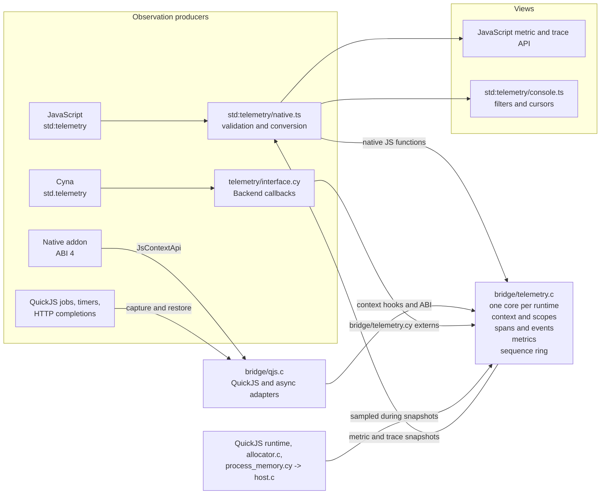
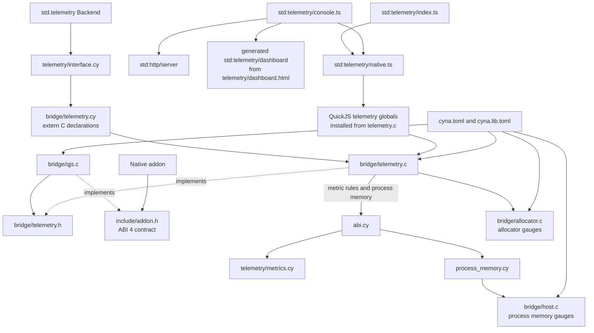

# Telemetry

Hao has one telemetry core per runtime. JavaScript, Cyna, native
extensions, QuickJS jobs, timers, and HTTP continuations all feed the same
metric registry, trace context, sequence space, and bounded trace ring in
`src/bridge/telemetry.c`. The JavaScript and console modules are views over
that core; they do not collect or reorder observations independently.

## Data flow

The data flow has three stages: producers validate and convert their inputs,
the native core records the observation, and views request filtered
projections from that core.



Every telemetry source enters the same per-runtime state. The core assigns
sequence numbers and records `source_kind` and `source`, so consumers can
filter a combined trace by layer without reconciling separate stores. Read
paths drain queued Cyna metrics and sample memory gauges before returning a
snapshot.

## Dependency flow

A solid arrow points from a consumer to the contract or implementation it
depends on. A dotted arrow identifies the implementation of a shared contract.
The TypeScript and Cyna public APIs converge on the same C core through
different boundaries.



`std:telemetry/index.ts` is the public JavaScript facade.
`std:telemetry/native.ts` owns JavaScript argument checking and conversion.
The Cyna `std.telemetry` implementation supplies a `Backend` through
`telemetry/interface.cy`; `bridge/telemetry.cy` contains only the raw extern
contract. `bridge/qjs.c` owns QuickJS lifetimes and async adapters.
`bridge/telemetry.c` owns collection and projection, while
`telemetry/metrics.cy` owns metric naming and operation rules exported through
`abi.cy`. The allocator and host units supply native memory observations for
the metric snapshot.

## JavaScript API

`std:telemetry` exposes counters, gauges, histograms, metric snapshots, root
and child spans, and the `trace(name, callback)` helper.

```ts
import { counter, metrics, trace } from "std:telemetry"

const calls = counter({ scope: "app", name: "calls", unit: "count" })
calls.add(1)
trace("app.request", () => handleRequest())
console.log(metrics())
```

`trace` closes its span when a synchronous callback finishes or a returned
Promise settles. QuickJS job-context hooks preserve the active trace across
`await`. Timer callbacks, HTTP worker completions, Cyna code, and native
extension callbacks can continue the same trace through the native context
API.

## Trace records

Start, event, and end records use a shared sequence and monotonic clock. Each
record contains trace, span, and parent IDs; name, status, timestamp, and
attributes; plus `source_kind` and `source` metadata. `source_kind` identifies
the emitting layer (`javascript`, `cyna`, or `addon`); `source` identifies the
addon module or other producer.

`snapshotTraceRecordsNative(since, limit, filter)` returns records after a
sequence cursor. Filters can select `source_kind`, `source`, `trace_id`,
`span_id`, `name`, `status`, and `since_ns`. A page contains `next_cursor` and
`missed`; `next_cursor` is the last sequence examined, including when the
filter returns no records, and `missed` is true when older matching history
has been overwritten.

The ring retains 4096 records by default. Set
`RUNTIME_TELEMETRY_TRACE_RECORDS` to a positive capacity up to 1,048,576 before
startup.

## Console

Set `RUNTIME_TELEMETRY_CONSOLE=1` to start the in-process console on loopback.
`RUNTIME_TELEMETRY_CONSOLE_PORT` chooses its port; zero selects an available
port. The console serves the dashboard, health, metrics, and trace endpoints.
Trace endpoints accept the same sequence, limit, and filter fields as the
native snapshot API.

## Metrics

Metrics include QuickJS memory gauges and process resident and physical
footprint gauges, including observed peaks. On macOS, allocator gauges use
malloc zone totals; on Linux they use `mallinfo2`. Native addon metrics and
JavaScript metrics share the runtime registry.

The Zig implementation remains on the `legacy` branch. The Cyna `main` branch
owns this unified observation plane; neither JavaScript nor the console owns a
second trace store.
